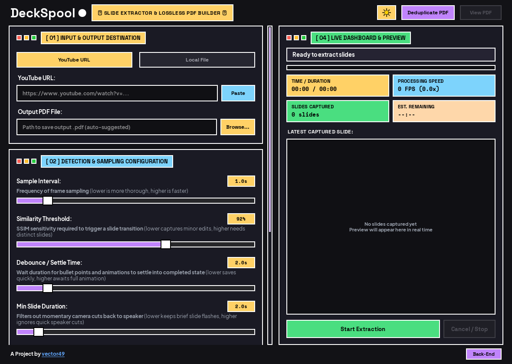
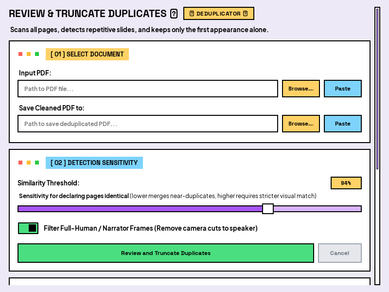

<p align="center">
  
</p>

<h1 align="center">DeckSpool</h1>

<p align="center">
  <strong>Smart Presentation Slide Extractor & Lossless PDF Builder</strong><br>
  Extract clean, unique slides from YouTube lectures, conference talks, and video recordings into crisp, lossless PDFs.
</p>

<p align="center">
  <a href="https://github.com/vector49/DeckSpool/releases"></a>
  
  
  
  <a href="LICENSE"></a>
</p>

<p align="center">
  <a href="https://github.com/vector49/DeckSpool/releases"><strong>⬇️ Download Windows Installer (.msi)</strong></a> •
  <a href="https://github.com/vector49/DeckSpool/releases"><strong>📦 Download Portable Edition (.zip)</strong></a> •
  <a href="#quick-start--installation"><strong>🚀 Run from Source</strong></a>
</p>

---

<p align="center">
  
  <br>
  <em>DeckSpool Neo-Brutalist Desktop Interface (Default Light Theme)</em>
</p>

---

## Overview

**DeckSpool** is a modern desktop application built with Python and PySide6 (Qt6) that automatically detects and extracts unique presentation slides from YouTube URLs or local video files and compiles them into clean, lossless PDF documents.

It is engineered to solve common video-to-slide extraction challenges:
- **Animated Bullet Points & Progressive Handwriting**: Eliminates duplicate partial builds by waiting for the slide content to stabilize.
- **Speaker Cutaways & Full-Human Shots**: Detects and purges speaker-only talking shots using onboard neural face detection (`YuNet`).
- **Webcam Overlays & Picture-in-Picture (PIP)**: Intelligently masks corner speaker cams to avoid false slide transitions.
- **Player Bars & Control Overlays**: Masks YouTube progress scrubbers and playback controls.
- **Letterboxing & Pillarboxing**: Auto-crops black borders for clean, edge-to-edge slide output.

---

## Quick Start & Installation

DeckSpool offers two official pre-compiled Windows releases alongside standard cross-platform source execution.

### Method 1: Pre-Compiled Windows Releases (Recommended)

Download the latest version from the [**GitHub Releases**](https://github.com/vector49/DeckSpool/releases) page:

#### A. Native Windows Installer (`.msi`)
- **Interactive Directory Selection**: Choose your preferred destination folder via the `"Change..."` directory browser or accept the standard default.
- **Windows Integration**: Creates Start Menu entries indexed by Windows Search, an optional Desktop shortcut, and registers a standard uninstaller in *Windows Installed Apps*.
- **Post-Install Instant Launch**: Check `"Run DeckSpool"` on the final wizard screen to launch immediately.
- **File**: `DeckSpool-v1.0.0-windows-x64-installer.msi`

#### B. Standalone Portable Package (`.zip`)
- **Plug & Play**: Extract the ZIP archive to any directory or USB drive and double-click `DeckSpool.exe`.
- **Zero Installation**: Completely self-contained; requires no administrator privileges or UAC elevation and makes no modifications to the Windows Registry.
- **Clean Removal**: Simply delete the folder when finished.
- **File**: `DeckSpool-v1.0.0-windows-x64-portable.zip`

---

### Method 2: Run from Source (Cross-Platform)

Ensure Python 3.10 or newer is installed on your system.

```bash
# 1. Clone the repository
git clone https://github.com/vector49/DeckSpool.git
cd DeckSpool

# 2. Create and activate a virtual environment (recommended)
python -m venv venv

# On Windows:
.\venv\Scripts\activate
# On Linux/macOS:
source venv/bin/activate

# 3. Install dependencies
pip install -r requirements.txt

# 4. Launch DeckSpool
python main.py
```

#### Core Dependencies
- `PySide6`: Modern, hardware-accelerated Qt6 desktop GUI framework.
- `yt-dlp`: Stream resolution and video ingestion without re-encoding.
- `opencv-python-headless`: Fast frame seeking, image transformation, and vectorized SSIM.
- `imagehash`: 64-bit perceptual difference hashing (`dHash`).
- `img2pdf`: Lossless image-to-PDF compiler without lossy re-compression.
- `pypdfium2`: High-speed PDF page rasterization and page extraction.
- `Pillow`: Image processing and thumbnail preview rendering.
- `scipy` & `numpy`: High-performance array operations.

---

### Building Official Releases from Source

To compile the standalone portable zip and native MSI installer locally on Windows:

```bash
# Requires WiX Toolset v3 installed on PATH (for MSI compilation)
python build_release.py
```

This compiles the core executable with PyInstaller, packages the portable `.zip`, synthesizes the WiX product definition, builds the `.msi` installer, and calculates cryptographic SHA-256 checksums (`SHA256SUMS.txt`) in `dist/release/`.

---

## User Interface & Dual Themes

DeckSpool features a signature Neo-Brutalist interface with high-contrast typography, responsive layout containers, and seamless one-click dark/light theme switching.

<p align="center">
  
  <br>
  <em>DeckSpool Neo-Brutalist Desktop Interface (High-Contrast Dark Theme)</em>
</p>

---

## Standalone PDF Review & Deduplication

In addition to live video processing, DeckSpool includes a dedicated standalone tool to inspect and clean existing PDF presentations.

<p align="center">
  
  <br>
  <em>Interactive PDF Deduplication & Speaker Cutaway Truncation Tool</em>
</p>

- **Keep First Appearance Alone**: Scans multi-page slide decks, identifies recurring duplicate slides (such as repeated agenda slides or title cards), and removes duplicates while preserving the initial instance.
- **Narrator Shot Purge**: Automatically detects and trims camera cuts of the speaker that were inadvertently captured in existing PDFs.
- **Custom SSIM Thresholding**: Fine-tune similarity matching (80% – 99%) and preview truncation counts before committing changes.

---

## Key Features

- **Modern Neo-Brutalist Native GUI**: Hardware-accelerated Qt6 desktop interface featuring smooth scrolling, responsive card containers, live visual telemetry, and dark/light themes.
- **Two-Tier Frame Sampling**:
  - Ultra-fast 360p grayscale analysis tier using combined 64-bit difference hashing (`dHash`) and vectorized OpenCV Structural Similarity Index (`SSIM`).
  - High-resolution source-native capture tier (up to 1080p) stored in memory buffers only when candidate transitions occur.
- **Debounced Slide Transition & Progressive Build Settle Engine**:
  - Handles animated bullet points, progressive handwriting, and slide animations by buffering candidate frames until visual content stabilizes for the configured settle time.
  - Commits only the final completed state of each slide, eliminating redundant duplicate slides.
- **Full-Human / Narrator Frame Filter (Speaker Cutaway Removal)**:
  - Automatically identifies camera shots of the teacher or speaker talking (full-human / narrator frames) using lightweight onboard neural face detection (`YuNet`) and edge density heuristics.
  - Distinguishes between full-frame presenter shots (which are filtered out) and small corner PIP webcams on presentation slides (which are preserved and masked).
  - Works during live video extraction and in the standalone PDF deduplication review tool to purge speaker-only shots from your final PDF.
- **Global PDF Review & Duplicate Truncation (Keep First Appearance Alone)**:
  - Scans the entire document or slide stream to find recurring duplicates (e.g., repeated agenda slides, title slides, or speaker cutbacks), truncating repetitive occurrences while preserving the first appearance.
  - Dedicated interactive modal tool (**"Review & Deduplicate PDF..."**) to inspect and clean any existing PDF file with live duplicate logs and custom thresholding.
  - Integrated into the video extraction pipeline with the **"Truncate Global Duplicate Slides"** toggle.
- **Presenter & PIP Masking**:
  - Exclude speaker webcam overlays to avoid false transition triggers.
  - Supports Auto-Detection (via motion variance analysis), corner presets (Top-Right, Bottom-Right, Bottom-Left, Top-Left), and custom normalized bounding boxes (`x,y,w,h`).
- **Player Chrome Masking**: Automatically masks the top 3% and bottom 5% of frames during analysis to ignore video titles, YouTube scrubber bars, and playback controls.
- **Canvas Auto-Crop**: Detects and eliminates black letterbox and pillarbox bars (e.g. 4:3 presentation within 16:9 canvas), exporting clean, edge-to-edge slide pages.
- **Lossless PDF Compilation**: Direct byte embedding using `img2pdf` to avoid lossy re-encoding artifacts.
- **Multi-Threaded Architecture**: Non-blocking background worker with thread-safe UI message queues, live console telemetry, and full cancellation support.

---

## Workflow

1. **Choose Source**: Select **YouTube URL** or **Local File**.
   - **YouTube**: Paste the video link (e.g., `https://www.youtube.com/watch?v=...`). The video title is automatically queried in the background to name your PDF.
   - **Local File**: Click **Browse...** to pick any `.mp4`, `.mkv`, `.mov`, `.avi`, or `.webm` presentation video.
2. **Configure Detection Parameters (Optional)**:
   - **Sample Interval**: 0.5s to 5.0s (Default: `1.0s`).
   - **Similarity Threshold**: 80% to 99% (Default: `92%`).
   - **Debounce / Settle Time**: 1.0s to 10.0s (Default: `2.0s`).
   - **Min Slide Duration**: 1.0s to 15.0s (Default: `2.0s`).
3. **Configure Preprocessing Toggles**:
   - **Mask Presenter / PIP**: Exclude speaker webcam overlays from slide analysis.
   - **Ignore Player Chrome**: Automatically mask player controls and scrubber bars.
   - **Canvas Auto-Crop**: Crop out black letterbox and pillarbox padding.
   - **Truncate Global Duplicate Slides**: Filter recurring duplicate slides throughout the deck, keeping only the first occurrence.
4. **Start Extraction**: Click the **Start Extraction** button. Monitor real-time progress, FPS, slide count, and live preview thumbnails.
5. **Open Document**: Once finished, click **Open PDF** or **Open Folder** directly from the completion modal.

---

## Documentation

- [Backend Architecture & Refactoring Specification](docs/specifications/backend_refactoring_spec.md)
- [Benchmark Test Suite](docs/benchmarks/DeckSpool_Benchmark_Test_Suite.docx)

---

## Automated Tests

Run the complete test suite:

```bash
python -m unittest discover tests
```

---

## License & Attributions

DeckSpool is free and open-source software licensed under the **[Apache License 2.0](LICENSE)**.

Copyright © 2026 **Vignesh Rajan (vector49)**.

### Third-Party Attributions:
- **YuNet Face Detector** (`deckspool/models/face_detection_yunet.onnx`): Developed by Shiqi Yu, licensed under Apache 2.0 / BSD 3-Clause.
- **Embedded Fonts** (`deckspool/assets/fonts/`): Space Grotesk, Plus Jakarta Sans, Space Mono, JetBrains Mono, Bricolage Grotesque, and Archivo Black are licensed under the [SIL Open Font License (OFL 1.1)](http://scripts.sil.org/OFL).
- **Branding & Trademark**: The DeckSpool name, logo, and iconography are proprietary brand identifiers of Vignesh Rajan (vector49).

See the [NOTICE](NOTICE) file for full attribution details.
