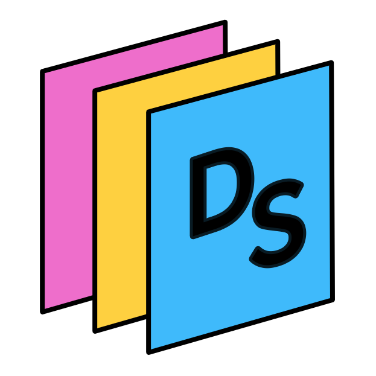

<p align="center">
  
</p>

<h1 align="center">YT2PDF (DeckSpool)</h1>

<p align="center">
  <strong>Smart Presentation Slide Extractor & Lossless PDF Builder</strong><br>
  Extract clean, unique slides from YouTube lectures, conference talks, and video recordings into crisp, lossless PDFs.
</p>

<p align="center">
  
  
  
</p>

---

## Overview

**YT2PDF** is a desktop application built with Python and PySide6 (Qt6) that automatically detects and extracts unique presentation slides from YouTube URLs or local video files and compiles them into clean, lossless PDF documents.

It is designed to solve common video-to-slide pain points: animated bullet points, progressive handwriting, webcam overlays, video player bars, and speaker camera cutaways.

---

## Key Features

- **Modern Neo-Brutalist Native GUI**: Hardware-accelerated Qt6 desktop interface featuring smooth scrolling, responsive card containers, live visual telemetry, and dark/light themes.
- **Two-Tier Frame Sampling**:
  - Ultra-fast 360p grayscale analysis tier using combined 64-bit difference hashing (`dHash`) and vectorized OpenCV Structural Similarity Index (`SSIM`).
  - High-resolution source-native capture tier (up to 1080p) stored in memory buffers only when candidate transitions occur.
- **Debounced Slide Transition & Progressive Build Settle Engine**:
  - Handles animated bullet points, progressive handwriting, and slide animations by buffering candidate frames until visual content stabilizes for the configured settle time.
  - Commits only the final completed state of each slide, eliminating redundant duplicate slides.
- **Full-Human / Narrator Frame Filter (Speaker Cutaway Removal)**:
  - Automatically identifies camera shots of the teacher or speaker talking (full-human / narrator frames) using lightweight onboard neural face detection (`YuNet`) and edge density heuristics.
  - Distinguishes between full-frame presenter shots (which are filtered out) and small corner PIP webcams on presentation slides (which are preserved and masked).
  - Works during live video extraction and in the standalone PDF deduplication review tool to purge speaker-only shots from your final PDF.
- **Global PDF Review & Duplicate Truncation (Keep First Appearance Alone)**:
  - Scans the entire document or slide stream to find recurring duplicates (e.g., repeated agenda slides, title slides, or speaker cutbacks), truncating repetitive occurrences while preserving the first appearance.
  - Dedicated interactive modal tool (**"Review & Deduplicate PDF..."**) to inspect and clean any existing PDF file with live duplicate logs and custom thresholding.
  - Integrated into the video extraction pipeline with the **"Truncate Global Duplicate Slides"** toggle.
- **Presenter & PIP Masking**:
  - Exclude speaker webcam overlays to avoid false transition triggers.
  - Supports Auto-Detection (via motion variance analysis), corner presets (Top-Right, Bottom-Right, Bottom-Left, Top-Left), and custom normalized bounding boxes (`x,y,w,h`).
- **Player Chrome Masking**: Automatically masks the top 3% and bottom 5% of frames during analysis to ignore video titles, YouTube scrubber bars, and playback controls.
- **Canvas Auto-Crop**: Detects and eliminates black letterbox and pillarbox bars (e.g. 4:3 presentation within 16:9 canvas), exporting clean, edge-to-edge slide pages.
- **Lossless PDF Compilation**: Direct byte embedding using `img2pdf` to avoid lossy re-encoding artifacts.
- **Multi-Threaded Architecture**: Non-blocking background worker with thread-safe UI message queues and full cancellation support.

---

## Installation

Ensure Python 3.10+ is installed on your system.

```bash
# Clone the repository
git clone https://github.com/vector49/YT2PDF.git
cd YT2PDF

# Install dependencies
pip install -r requirements.txt
```

### Dependencies
- `PySide6`: Modern, hardware-accelerated Qt6 desktop GUI framework.
- `yt-dlp`: Fast stream resolution and video ingestion without re-encoding.
- `opencv-python-headless`: Fast frame seeking, image transformation, and vectorized SSIM.
- `imagehash`: 64-bit perceptual difference hashing (`dHash`).
- `img2pdf`: Lossless image-to-PDF compiler without re-compression.
- `pypdfium2`: High-speed PDF page rasterization and lossless page pruning.
- `Pillow`: Image processing and thumbnail preview rendering.
- `scipy` & `numpy`: High-performance array operations.

---

## Usage

Launch the desktop GUI:

```bash
python main.py
```

### Workflow
1. **Choose Source**: Select **YouTube URL** or **Local File**.
   - **YouTube**: Paste the video link (e.g., `https://www.youtube.com/watch?v=...`). The video title is automatically queried in the background to name your PDF.
   - **Local File**: Click **Browse...** to pick any `.mp4`, `.mkv`, `.mov`, `.avi`, or `.webm` presentation video.
2. **Configure Detection (Optional)**:
   - **Sample Interval**: 0.5s to 5.0s (Default: `1.0s`).
   - **Similarity Threshold**: 80% to 99% (Default: `92%`).
   - **Debounce / Settle Time**: 1.0s to 10.0s (Default: `2.0s`).
   - **Min Slide Duration**: 1.0s to 15.0s (Default: `2.0s`).
3. **Configure Preprocessing**:
   - Toggle **Mask Presenter / PIP** if a webcam overlay is present.
   - Toggle **Ignore Player Chrome** (default: On) to mask player controls.
   - Toggle **Canvas Auto-Crop** to eliminate black borders around slides.
4. **Start Extraction**: Click the **Start Extraction** button. Monitor real-time progress, FPS, slide count, and live preview thumbnails.
5. **Open Document**: Once finished, click **Open PDF** or **Open Folder** directly from the completion modal.

---

## Documentation

- [Backend Architecture & Refactoring Specification](docs/specifications/backend_refactoring_spec.md)
- [Benchmark Test Suite](docs/benchmarks/YT2PDF_Benchmark_Test_Suite.docx)

---

## Automated Tests

Run the complete test suite:

```bash
python -m unittest discover tests
```
